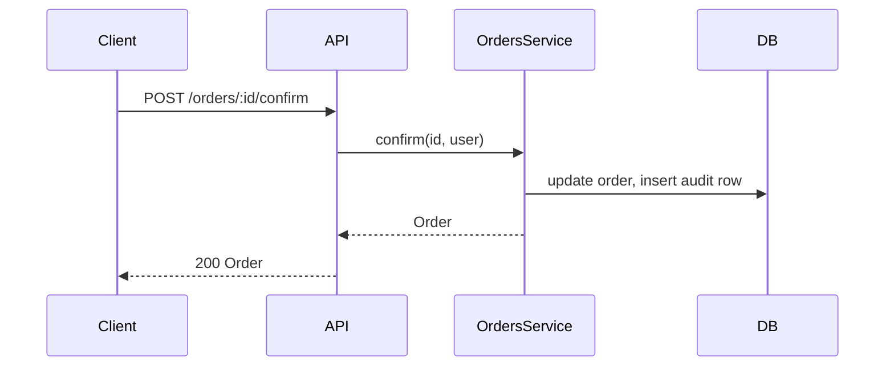

# DFA - Design first approach

> Design first approach is a methodology that puts designing a software system before writing any code: a plan that outlines the architecture, components, and interfaces. The goal is a well-thought-out system that meets users' needs and is easy to maintain and extend.
>
> Benefits:
>
> * **Reduced rework:** careful planning avoids rewriting code later.
> * **Improved quality:** thinking through scenarios up front catches bugs before they exist.
> * **Increased maintainability:** the design documents are a roadmap for how the system works and how to change it.
> * **Improved communication:** everyone works towards a common, written goal.
>
> Simplified flow: gather requirements → high-level design → detailed design → implement → test. Design is iterative: update the DFA as the system evolves.

## DFA blueprint

1. **Feature description**
    1. **1.1 Why?**
    1. **1.2 Goal**
    1. **1.3. Challenges / Risks**
1. **Non-functional requirements**
1. **Sequence Diagram**
1. **Actions**
1. **C4 Diagrams**
1. **Database structure**
1. **API documentation**
1. **Test coverage requirements**
1. **Impact summary**

Header of the produced file (before section 1):

```markdown
# <Feature title>

- Date: <YYYY-MM-DD>
- Source: <prompt | file path | URL | issue reference>
```

### 1. Feature description

#### 1.1. Why?

Describe the business reason for the feature. Why do we need it? What problem does it solve? Keep it short, without longreads.

#### 1.2. Goal

Describe the expected result and outcome. Keep it short, without longreads.

#### 1.3. Challenges / Risks

Describe the possible blockers, risks, and challenges.

### 2. Non-functional requirements

Technical goals that are not described in business requirements. Possible topics:

- Performance
- Security
- Scalability
- Maintainability
- Reliability
- Usability

No need to describe each of them — only what really makes sense in the scope of this feature.

The default assumption is that the feature does not change the non-functional requirements. Do not make the system slower or less secure in general.

### 3. Sequence Diagram

Describe the sequence of actions required to achieve the goal. Use [Mermaid sequenceDiagram](https://mermaid.js.org/syntax/sequenceDiagram.html) syntax. Write as many diagrams as needed to describe the flow.

Example:



### 4. Actions

What exact actions need to be done to achieve the Goal. Describe which code units (modules, classes, functions, components, hooks, routes, etc.) need to be created or updated. The more detailed the better. Example:

> - Create `OrdersConfirmDto` — validates the confirm payload
> - Create `OrdersService.confirm()` — checks ownership, sets `confirmedAt`, emits `order.confirmed`
> - Update `OrdersController` (or `OrdersResolver`)
>   - Add `POST /orders/:id/confirm` (or the `confirmOrder` mutation)
>   - Guard it with the existing auth guard
> - Add a migration for the new `confirmed_at` column

This description must be valid and understandable for a developer who is going to implement the feature (you don't know who).

### 5. C4 diagrams

Describe containers and/or components using the [C4 model](https://c4model.com). Describe only the levels that make sense for the feature. If there are no architectural changes — no diagrams required.

Prefer text-based diagrams (Mermaid C4 or PlantUML) kept in the same directory as the DFA (`.mmd` / `.puml`); embed or link them here.

### 6. Database structure

Describe the database structure changes. Prefer [DBML syntax](https://dbml.dbdiagram.io/home). Avoid "drawing" as much as possible; use text format instead. If possible, describe the required changes exactly in the project's ORM / migration syntax (TypeORM, Prisma, Sequelize, Knex, …). Example:

```dbml
// New table
Table users {
  id integer [primary key]
  username varchar
  created_at timestamp
}

// Modified table
Table posts {
  id integer [primary key]
  user_id integer
  body text [note: 'Newly added column']
}

Ref: posts.user_id > users.id
```

For minor changes, you can also use a simple list:

#### New

- add `my_new_column` to `my_table`
- ...

#### Changed

- rename `my_old_column` to `my_new_column` in `my_table`
- ...

#### Removed

- remove `my_old_column` from `my_table`
- ...

Mention data backfills, indexes, and migration order/reversibility where they matter.

### 7. API documentation

Describe API changes in the project's API style: REST routes, GraphQL operations and types, WebSocket events, or exported function / component signatures. Include request and response shapes. Use the following structure:

#### New

- add `GET /api/my_resource/:id` endpoint
- add GraphQL mutation `confirmOrder(id: ID!): Order!`

#### Changed

- rename `PATCH /api/users/:id/update` to `PATCH /api/users/:id`

#### Removed

- remove `DELETE /api/posts/:id`

### 8. Test coverage requirements

Describe the scenarios worth testing (happy path, validation errors, authorization, edge cases) and at which level (unit, integration, e2e) in the project's test runner (Jest, Vitest, …). Default requirement: do not reduce existing test coverage.

### 9. Impact summary

**Which modules are impacted by this change.** One row per impacted module. Name modules exactly — "various services updated" is unusable.

| Module | Change | Notes |
| --- | --- | --- |
| `OrdersService` | new `confirm()` method | owner of the change |
| `OrdersController` | new `POST /orders/:id/confirm` | contract change, FE must adapt |
| `PaymentsService` | called from `OrdersService.confirm()`; behaviour unchanged | only touched |
| `orders` table | new `confirmed_at` column, backfill required | migration |

Include modules you only **touch** (like `PaymentsService` above), not just the ones you own — their own tests may not cover the new usage, which makes them the likeliest regression.

---

_P.S. if the feature description requires additional sections, feel free to add them. For example, a **0. Glossary** section to describe terms used in the feature description, or a **10. Additional information** section for anything not covered above._
